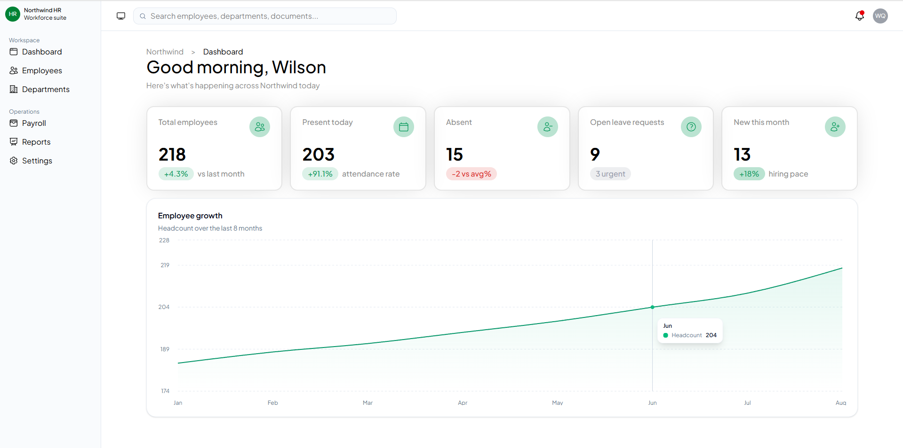
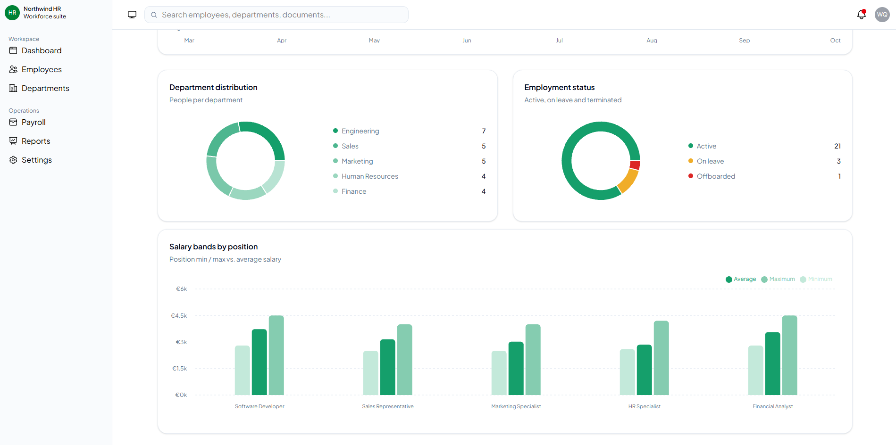
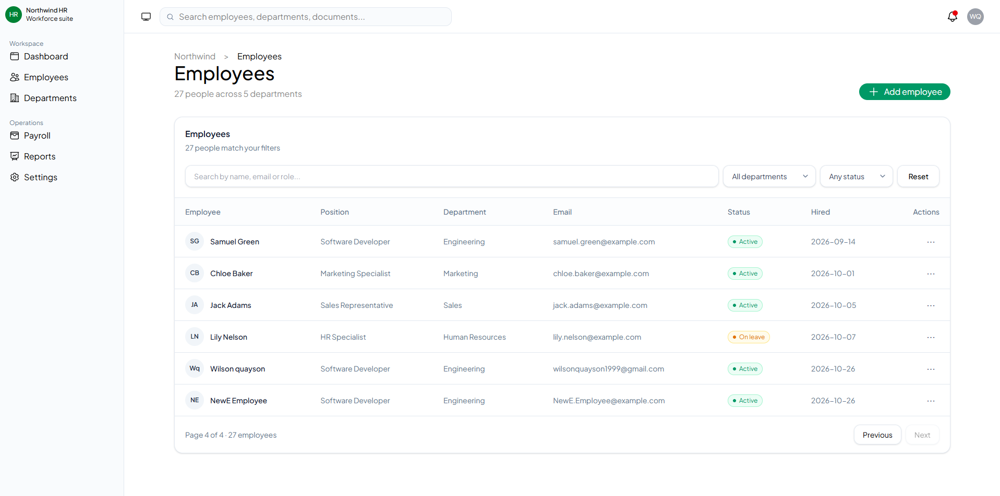

# Employee Manager

A full-stack employee management application built with **React, TypeScript, ASP.NET Core, and SQL Server**.

The application provides a centralized interface for managing employees, departments, and job positions, alongside an interactive dashboard that visualizes workforce data.

The backend follows **Onion Architecture**, separating business logic, domain models, and data access to improve maintainability and scalability.

## Features

### Dashboard

- Overview dashboard with key workforce metrics
- Employee distribution by department
- Employment status distribution
- Salary analysis by job position
- Interactive charts using Recharts

### Employee Management

- View and manage employee records
- Create employees through a form with validation
- Search employees by name, email, or job position
- Filter employees by department and employment status
- Paginated employee table
- Success and error notifications

### Backend

- RESTful API built with ASP.NET Core
- Onion Architecture with separate Domain, Application, Infrastructure, and API layers
- Entity Framework Core for database operations
- SQL Server for persistent data storage
- Repository and service layers for data access and business logic
- DTOs for request and response models
- Data validation and business rules
- API documentation and testing through Swagger

## Tech Stack

| Frontend | Backend |
|---|---|
| React | C# / ASP.NET Core |
| TypeScript | Entity Framework Core |
| Vite | SQL Server |
| Tailwind CSS | REST API |
| TanStack Query | Swagger / OpenAPI |
| React Router | Onion Architecture |
| Recharts | Repository Pattern |

## Architecture

The application is divided into a React frontend and an ASP.NET Core backend.

The backend follows **Onion Architecture**, organizing responsibilities into four separate layers:

- **Domain:** Contains core entities, enums, and domain models.
- **Application:** Contains business logic, services, DTOs, and interfaces.
- **Infrastructure:** Handles database communication using Entity Framework Core and repository implementations.
- **API:** Exposes REST endpoints through controllers and configures dependency injection.

This architecture separates business logic from infrastructure concerns, making the application easier to maintain, test, and extend.

### Request Flow

```text
React Frontend
      |
      v
ASP.NET Core API
      |
      v
Application Services
      |
      v
Repository Interfaces
      |
      v
Infrastructure (EF Core)
      |
      v
SQL Server Database
```

## Screenshots

### Dashboard







## Project Structure

```text
EmployeeManager/
├── API/
│   ├── src/
│   │   ├── EmployeeManager.Api/
│   │   │   ├── Controllers/
│   │   │   ├── Program.cs
│   │   │   └── appsettings.json
│   │   │
│   │   ├── EmployeeManager.Application/
│   │   │   ├── DTOs/
│   │   │   ├── Interfaces/
│   │   │   └── Services/
│   │   │
│   │   ├── EmployeeManager.Domain/
│   │   │   ├── Entities/
│   │   │   └── Enums/
│   │   │
│   │   └── EmployeeManager.Infrastructure/
│   │       ├── Data/
│   │       ├── Repositories/
│   │       └── Migrations/
│   │
│   └── EmployeeManager.sln
│
├── Client/
│   ├── public/
│   ├── src/
│   │   ├── api/
│   │   ├── assets/
│   │   ├── components/
│   │   ├── layouts/
│   │   ├── pages/
│   │   ├── router/
│   │   ├── types/
│   │   ├── main.tsx
│   │   └── index.css
│   ├── docs/
│   │   └── screenshots/
│   ├── package.json
│   ├── vite.config.ts
│   ├── tsconfig.json
│   ├── eslint.config.js
│   └── index.html
```

## Getting Started

### Prerequisites

- Node.js and npm
- .NET SDK compatible with the API project
- SQL Server or SQL Server Express
- Visual Studio or another compatible IDE

### 1. Clone the Repository

```bash
git clone <repository-url>
cd EmployeeManager
```

### 2. Configure the Backend

Navigate to the API project:

```bash
cd API/src/EmployeeManager.Api
```

Configure your SQL Server connection string in `appsettings.json` or through user secrets.

Apply the Entity Framework Core migrations using the appropriate startup and infrastructure projects.

### 3. Run the Backend

```bash
dotnet run
```

The API must be running before the frontend can retrieve employee data.

### 4. Install Frontend Dependencies

From the repository root:

```bash
cd Client
npm install
```

### 5. Run the Frontend

```bash
npm run dev
```

The Vite development server will typically start at:

```text
http://localhost:5173
```

### 6. Build the Frontend

```bash
npm run build
```

## Future Improvements

- Employee editing and deletion through the user interface
- Expanded department and job position management
- Additional dashboard analytics
- Improved form validation and error handling
- Authentication and authorization

## License

This project was developed for learning, portfolio, and demonstration purposes.
